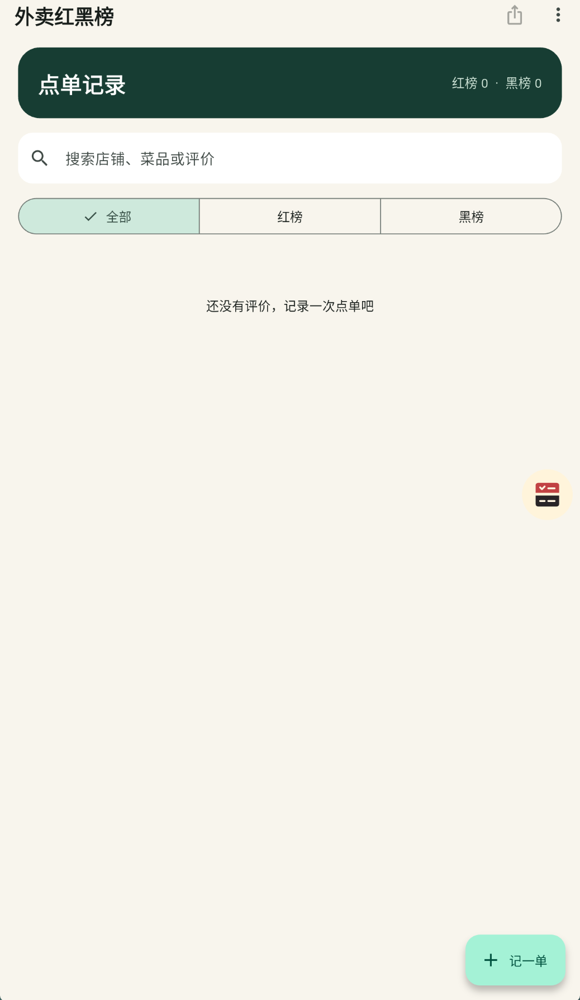

# 外卖红黑榜

记录吃过的店铺和菜品，按红榜、黑榜筛选，也可以搜索历史评价。

- Android 和 iOS 共用红黑榜界面，支持记录、搜索和筛选评价，数据保存在设备上。
- 通过系统分享菜单发送评价，好友复制完整内容后可在应用里导入。
- Android 支持悬浮窗。在外卖店铺页点击悬浮图标，即可识别店名、查看历史评价或记一单。



运行 Android 版时连接设备或启动模拟器。运行 iOS 版时使用安装了 Xcode 的 Mac，并启动 iOS 模拟器。

```powershell
flutter pub get
flutter run
```
